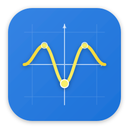

<p align="center">
  
</p>

<h1 align="center">Grafito</h1>

<p align="center">
  <b>Das Mathe- und Physiklabor, das erklärt, bevor es zeigt.</b><br/>
  Interaktive Geometrie, Computeralgebra, Statistik, Analysis und
  <b>67 visuelle Physik-Labore</b> + Sokratischer Tutor + Whiteboard —
  100% natives Rust, minimalistische skandinavische Ästhetik.
</p>

---

## Highlights

- **764 Befehle** (spanische und englische Aliase) mit zweisprachiger Fuzzy-Palette (`Ctrl+K`).
- **GPU-beschleunigtes 2D/3D-Canvas**: Compute-Shader kompilieren Nutzer-Ausdrücke zur Laufzeit nach WGSL.
- **Geometrie mit Nebenbedingungen**: Newton-Solver mit analytischen Jacobi-Matrizen; persistente Loci; boolesche Polygonoperationen.
- **Echtes CAS**: Risch–Norman-Integration, Gruntz-Grenzwerte, Gröbner-Basen, exakte rationale Lineare Algebra bis 32×32, gewöhnliche Differentialgleichungen, Schritt-für-Schritt-Karten.
- **3D + 4D**: implizite/parametrische Flächen, die sechs regulären Polychora und Simplex/Hyperwürfel-Familien in 3–10D.
- **67 Physik-Labore** mit semantischer Palette (eine Farbe = eine Bedeutung) und 64 Copy-Paste-Rezepten.
- **70 Animationsvorlagen** (im 3Blue1Brown-Stil): GIF/MP4/WebM-Export, SRT/ASS-Untertitel, Piper-TTS-Sprecher.
- **Sokratischer Tutor**: 68 Lernziele, 18 deterministische Übungsfamilien, BKT + Leitner-Mastery, Prüfungsmodus.
- **P2P-Klassenzimmer** ohne Konten; **Obsidian-Brücke** mit re-ausführbaren ```grafito```-Rezeptblöcken.
- **MCP-Server** (70 Tools) + **Agentenmodus** mit Live-Transcript der Werkzeuge.

## Installation

| Plattform | So geht's |
|---|---|
| Linux x86_64 | `grafito-linux-x64.tar.gz` aus den [Releases](https://github.com/Diez111/Grafito/releases) — glibc 2.35+ und `libdbus-1-3` |
| Windows x64 | `grafito-windows-x64.zip` portabel — entpacken und `grafito.exe` starten |
| macOS | `grafito-macos-*.tar.gz` (x86_64 / arm64) |
| Quellcode | `git clone` + `cargo run -p grafito-app --release` (Rust ≥ 1.92) |

## Schnellstart

```text
y = sin(x)                 # lebendige Funktion
k = 3                      # automatischer Slider
Derivative[sin(x)]         # symbolische Ableitung
Root[sin(x)]               # Nullstellen auf dem Canvas
```

`Ctrl+K` öffnet die vollständige Palette. Lehrer-Guide in 5 Minuten:
[README auf Spanisch](README.es.md#guía-docente-en-5-minutos), Rezepte in
[`docs/fisica-animada.md`](docs/fisica-animada.md).

## Dokumentation

- [Architektur](docs/architecture.md) · [Befehlskatalog](docs/commands.md) · [Animations-Engine](docs/animation-engine.md)

## Mitwirken und Lizenz

PRs willkommen — `cargo fmt` und `cargo clippy -D warnings` sind Pflicht
(17 CI-Jobs). **GPL-3.0-or-later** — siehe [LICENSE](LICENSE).

> 🌐 Oberfläche verfügbar auf Deutsch, Spanisch, Englisch, Portugiesisch, Italienisch und Französisch.
