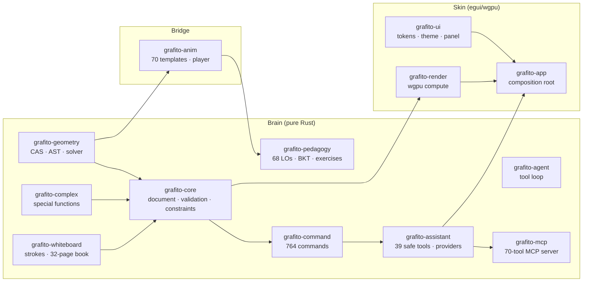

<p align="center">
  
</p>

<h1 align="center">Grafito</h1>

<p align="center">
  <a href="https://github.com/Diez111/Grafito/releases"></a>
  <a href="LICENSE"></a>
  <a href="https://www.rust-lang.org"></a>
  <a href="https://github.com/Diez111/Grafito/stargazers"></a>
</p>

<p align="center">
  <b>The math & physics lab that explains before it shows.</b><br />
  Interactive geometry, computer algebra, statistics, calculus and
  <b>67 visual physics labs</b> + a Socratic tutor assistant + a whiteboard —
  100% native Rust, with a minimalist Scandinavian aesthetic.
</p>

---

## Why Grafito

| | Grafito | Typical web math apps |
|---|---|---|
| Runtime | Native binary (~50 MB), starts in ~1 s | Browser + cloud |
| Privacy | **Local-first**: your work never leaves the machine | Telemetry / accounts |
| Reproducibility | Seeded generators — same seed ⇒ same exercise, byte-identical | n/a |
| AI era | **MCP server** (70 tools) + agent mode with live tool transcript | Chat sidebar |
| Animation | 70 native templates (3Blue1Brown-style), GIF/MP4 export | Static plots |
| Honesty | Typed errors — if it can't compute it, it says so | Silent fallbacks |

## Highlights

- **764 commands** (Spanish + English aliases) with a fuzzy bilingual command palette.
- **GPU-accelerated** 2D/3D canvas: compute shaders compile user expressions to WGSL at runtime (250k cells/dispatch for domain coloring).
- **Geometry with constraints**: Newton solver with analytic Jacobians; persistent loci; boolean polygon ops; conics by construction.
- **Real CAS**: Risch–Norman integration, Gruntz limits, Buchberger Gröbner bases (bounded), exact rational linear algebra up to 32×32, ODEs, Laplace, step-by-step cards.
- **3D + 4D**: parametric surfaces, implicit surfaces (marching tetrahedra), the six regular polychora and simplex/hypercube/cross-polytope families in 3–10D.
- **67 physics labs** with a semantic color palette (one color = one meaning) and 64 copy-paste recipes.
- **70 animation templates** (3Blue1Brown-style): rotating radius, epicycles, matrix transformations, backprop flow, chaos — export to GIF (native, ≤5 MB) / MP4 / WebM / PNG-seq, with SRT/ASS captions and Piper TTS voiceover.
- **Socratic tutor**: 68 learning objectives (UTN curriculum), 18 seeded exercise families, BKT + Leitner mastery tracking, exam mode that locks the assistant.
- **Classroom (P2P)**: teacher/student roles, QR invite, chat — no accounts, no cloud.
- **Obsidian bridge**: export lessons as re-playable Markdown (```grafito``` recipe blocks + slider tables) into your vault; the agent can list/read/write/organize vault notes inside a strict sandbox.
- **Whiteboard**: 32-page book with ruler/protractor/compass, WYSIWYG eraser, stamps — lives inside the document.

## Install

<details>
<summary><b>Linux x86_64 (.tar.gz)</b></summary>

```bash
sudo apt install libdbus-1-3   # runtime D-Bus
wget https://github.com/Diez111/Grafito/releases/latest/download/grafito-linux-x64.tar.gz
tar -xzf grafito-linux-x64.tar.gz
./grafito
```
Built and smoke-tested on Ubuntu 22.04 (glibc 2.35+). Requires a Vulkan/OpenGL driver for GPU compute.
</details>

<details>
<summary><b>Windows x86_64 (.zip, portable)</b></summary>

Download [`grafito-windows-x64.zip`](https://github.com/Diez111/Grafito/releases/latest/download/grafito-windows-x64.zip), extract, run `grafito.exe`. No installer needed.
</details>

<details>
<summary><b>macOS (x86_64 / arm64)</b></summary>

Download the matching `grafito-macos-*.tar.gz` from [Releases](https://github.com/Diez111/Grafito/releases), extract and run.
</details>

<details>
<summary><b>Build from source</b></summary>

```bash
git clone https://github.com/Diez111/Grafito.git
cd Grafito
cargo run -p grafito-app --release
```

Requires Rust ≥ 1.92 and a C compiler. The default build needs no C math
libraries; the opt-in `cas-nativo` feature additionally needs
GMP/MPFR/MPC + FLINT.
</details>

## Quick start

Type into the input bar and press Enter — Grafito reads natural math notation:

```text
(x - 2)^2 + (y - 3)^2 = 25          # circle
y = sin(x)                          # function (blue curve appears)
k = 3                               # creates a live slider
Derivative[sin(x)]                  # symbolic: cos(x)
Root[sin(x)]                        # roots marked on canvas
Animate[k, 0, 10, 1]                # animate the slider
```

Or grab a tool (F1–F6) and construct by clicking. Press `Ctrl+K` for the
full command palette (fuzzy, Spanish/English). `F1` = Select, `F2` = Point,
`F3` = Line, `F4` = Circle, `F5` = Polygon, `F6` = Function.

### Teacher in 5 minutes

1. Open `docs/fisica-animada.md` — 64 copy-paste recipes (projectile motion, dipole, RLC, Doppler, Carnot…).
2. Paste 1–3 commands; the lab draws with semantic colors (green = velocity, red = acceleration, amber = light).
3. Drag a slider — the class asks "what if…?" and the canvas answers live.
4. Export the GIF (≤5 MB, native) for your LMS.
5. Assess with the tutor: seeded exercises with exact solutions and misconception feedback.

## Architecture

Grafito is a strict two-layer system — **Brain** (pure Rust, deterministic,
no UI dependencies) and **Skin** (egui/wgpu, renders `&State` only):



- **764 commands**, **89 toolbar tools**, **70 animation templates**, **39+ safe assistant tools**, **70-tool MCP server** — all counts pinned by tests (`registry_counts_match_documented_architecture`).
- Deterministic documents: `BTreeMap` everywhere, byte-identical saves, seeded exercise generation.
- Fail-closed validation: `ValidatedDocument` wrapper gates every persist; budgets (10 MB doc, 5000 objects, 2000-char expressions) enforced in `validation.rs`.
- Full details: [`docs/architecture.md`](docs/architecture.md) (crate DAG, state machines, budgets table, doc→code pin table).

## Project layout

```
crates/
├── grafito-app/               Application (eframe/egui) — UI, input, orchestration
├── grafito-command/           Text commands: registry (764), CAS parse
├── grafito-core/              Document, objects, constraints, persistence
├── grafito-geometry/          Math brain — CAS, stats, ODEs, fractals
├── grafito-render/            wgpu pipeline — 2D/3D, compute shaders
├── grafito-ui/                egui components — toolbar, palette, themes
├── grafito-anim/              Animation protocol (70 templates) + native GIF
├── grafito-assistant/         Pedagogical tutor agent (multi-provider LLM)
├── grafito-agent/             Agent tool loop (provider-agnostic)
├── grafito-assistant-types/   Shared assistant wire types + budgets
├── grafito-pedagogy/          Curriculum (68 LOs), exercises, feedback
├── grafito-whiteboard/        Whiteboard: strokes, shapes, 32-page book
├── grafito-complex/           Complex special functions (γ, ζ, Bessel…)
├── grafito-ggb/               GeoGebra interop (import/export .ggb)
├── grafito-lab/               Hadwiger–Nelson lab (SAT/Lean verification)
├── grafito-classroom/         Classroom P2P (opt-in iroh transport)
├── grafito-tex/               Offline LaTeX → SVG (STIX Two Math)
├── grafito-mcp/               MCP server (stdio, JSON-RPC 2024-11-05)
├── grafito-plugins/           Declarative plugin system (fail-closed)
└── grafito-profile/           Learning memory (BKT + Leitner)
```

## Documentation

| Doc | What's inside |
|---|---|
| [docs/architecture.md](docs/architecture.md) | Crate DAG, state machines, budgets, doc→code pins |
| [docs/commands.md](docs/commands.md) | Generated command catalog (861 entries with aliases) |
| [docs/animation-engine.md](docs/animation-engine.md) | Animation protocol, budgets, export formats |
| [docs/fisica-animada.md](docs/fisica-animada.md) | 64 physics recipes (ES) |
| [docs/spec/assistant.md](docs/spec/assistant.md) | Assistant security & privacy threat model |
| [docs/plugin-format.md](docs/plugin-format.md) | Plugin manifest format (fail-closed validation) |

## Contributing

PRs welcome. `cargo fmt --all -- --check` and
`cargo clippy --workspace --all-targets -- -D warnings` must pass — CI
enforces both on every push, plus a 17-job matrix (MSRV 1.92 + stable,
GPU regressions via lavapipe, Debian packaging, supply-chain audit,
CodeQL, weekly fuzzing). See [CONTRIBUTING.md](CONTRIBUTING.md).

## License

GNU General Public License v3.0 or later — see [LICENSE](LICENSE).
No third-party code was copied; inspiration credits and verified licenses
of every idea source are listed in the acknowledgments section of the
Spanish README ([README.es.md](README.es.md#inspiración-y-créditos)).

## Language

The app UI ships in **English, Spanish, Portuguese, Italian, French and
German** (1,480 strings, pinned by tests). Documentation: English first
(this file); deep-dive docs in `docs/` are bilingual ES/EN.
