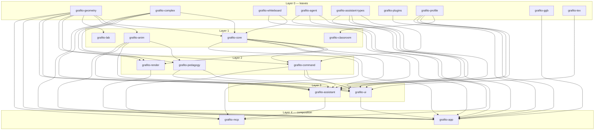
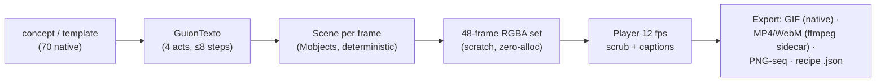
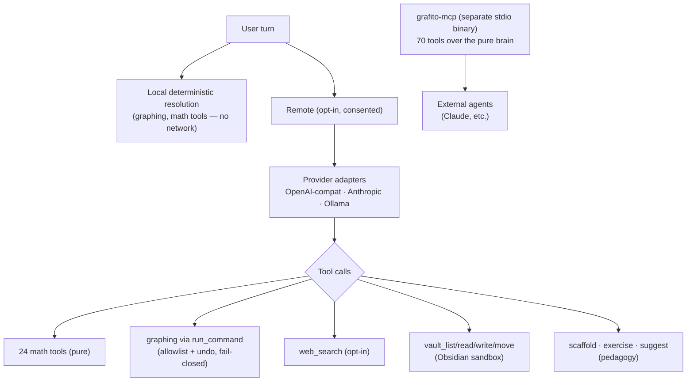

# Grafito Architecture

> Source of truth for v1.3.0. Every number in this document is pinned by a
> test or measured with a command recorded in the
> [doc→code pin table](#doccode-pins). English-first (2026-10-17); the
> historical Spanish source remains at
> [`docs/architectura-es.md`](architectura-es.md) and other deep-dive docs
> under `docs/` are bilingual ES/EN.

Grafito is a strict two-layer system:

- **Brain** — pure Rust, deterministic, no UI dependencies (no egui/wgpu).
  Invariants validated, `Result`/`Option` at boundaries, `unwrap` denied
  workspace-wide.
- **Skin** — egui/wgpu. Renders `&State` only: no I/O, no spawning, no
  business logic.

## 1. Crate DAG

All 20 crates, verified acyclic (arrows = "depends on"):

Layer rules enforced by review + CI:

- **L0** depends on nothing internal. `grafito-geometry` is the math brain:
  AST + compiled flat-opcode evaluation (87.6 ns cached vs 7.4 µs
  interpreted — measured, see `docs/profiling.md`), CAS (Risch–Norman,
  Gruntz, Buchberger), interval arithmetic, ODEs, statistics, fractals.
- **L1** `grafito-core` owns the document: `BTreeMap` determinism,
  `ValidatedDocument` fail-closed persistence wrapper, constraint graph,
  budgets. `grafito-anim` is the native animation bridge (IPC stdio JSON v1
  + in-process renderer).
- **L2** `grafito-command` is the typed command registry (**764**
  `command!()` registrations, pin test). `grafito-render` owns all wgpu:
  9 compute pipelines, lyon tessellation, domain coloring (250k
  cells/dispatch).
- **L3** `grafito-assistant` aggregates 9 crates into the pedagogical agent
  (multi-provider LLM: OpenAI-compatible / Anthropic Messages / Ollama
  loopback; streaming + reasoning + token usage on all three).
  `grafito-ui` is the design system (Nordic Slate tokens, 1,480 i18n keys
  ×6 locales).
- **L4** `grafito-app` is the only crate allowed to know everything
  (composition root). `grafito-mcp` is a standalone stdio server over the
  pure brain — never touches the UI, never the network.

## 2. State machines

Key flows are typed enums where illegal transitions don't compile:

| Machine | States (abridged) | Crate |
|---|---|---|
| `AnimJob` | Idle → Spawning → AwaitingHello{deadline} → AwaitingPong → Ready → Running{job_id} → Cancelling → Completed{media} / Failed{code} / TimedOut | grafito-anim |
| `DocumentLifecycle` | Empty → Loading → Validating → Ready → Mutating → Persisting → Ready | grafito-core |
| `AssistantRuntime` | Idle → Composing → Thinking → AwaitingAuthorization → Animating{job_id} → Failed / Cancelled | grafito-app |
| `Interval`/`ExprEval` | Raw → Parsed → Validated → Evaluated / Failed | grafito-geometry |

## 3. Budgets (all enforced, all pinned)

| Domain | Constant | Value |
|---|---|---|
| Document | `MAX_DOCUMENT_SIZE_BYTES` | 10 MB |
| Document | `MAX_OBJECT_COUNT` | 5000 |
| Expression | `MAX_EXPR_LENGTH` | 2000 |
| Matrix | `MAX_MATRIX_ELEMENTS` | 1M |
| Undo | `MAX_UNDO` / `MAX_UNDO_BYTES` | 50 / 50 MiB (VecDeque, O(1)) |
| Animation | frames GIF / long-form | 64 / 1500 |
| Animation | timeline / chunk | 60 s / 64 MiB streaming |
| Captions | SRT/ASS output | 256 KiB preventive |
| Assistant | input / output / steps / timeout | 8192 / 2048 / 8 / 60 s |
| Attachments | bytes / total / pixels / count | 512 KiB / 1 MiB / 2 MiP / 2 |
| Vault tools | read / write / list | 256 KiB / 64 KiB / 512 entries |
| i18n | catalog × locales | 1,480 × 6 (100% coverage, test-pinned) |

## 4. Animation pipeline

Templates triple-sync across `CANONICAL_TEMPLATES` ↔ `NATIVE_TEMPLATES` ↔
`PLANTILLAS_COMBO` (70↔70↔70) plus the agent mirror — pinned by parity
tests and per-template FNV-1a golden hashes.

## 5. Assistant & MCP

Safety contract (`docs/spec/assistant.md`): local resolution needs no
transport; remote proposals are typed, re-verified against the *current*
document, applied only after explicit consent, and always undoable.
Prompts wrap untrusted context in `<datos_no_confiables>` delimiters
(anti prompt-injection). Keys live in the system keyring — never in
config, logs or payloads.

## 6. CI (17 jobs)

| Gate | Detail |
|---|---|
| `check` / `test` / `lint` | matrix MSRV 1.92 + stable, `--locked`, Windows-GNU target check |
| `gpu-compute` | required Vulkan (lavapipe) regressions, `GRAFITO_REQUIRE_GPU_TESTS=1` |
| `fmt` / `docs` | rustfmt + rustdoc `-D warnings` |
| `supply-chain` | `cargo-audit` + `cargo-deny` (advisories, licenses, duplicate crates) |
| `package-debian` | build + lintian + install/purge smoke |
| `workflow-lint` | actionlint + shellcheck + packaging fixtures |
| weekly | coverage (71% line gate), mutation, fuzzing (8 targets × 180 s), bench |
| release | tag validation → 4-target build → SBOM (syft) → SHA256SUMS → attestations |

## 7. Type safety

- Newtypes with `try_new`: `AnimJobId`, `Resolution` (64..=4096),
  `AnimDuration` (0.1..=60 s), `Interval(prec, lo, hi)`.
- Workspace lints: `warnings = "deny"`, `unsafe_code = "deny"` (documented
  per-site exceptions only), `clippy::unwrap_used = "deny"`
  (`allow-unwrap-in-tests = true`).
- Determinism: domain maps are `BTreeMap`; saves are byte-identical;
  `panic = "unwind"` retained deliberately for `catch_unwind` bridges.

## Doc→code pins

| Claim | Origin |
|---|---|
| RequestBudget 8192/2048/8/60 s | `crates/grafito-assistant-types/src/lib.rs` |
| 764 commands | pin test `registry_counts_match_documented_architecture` |
| 70 animation templates | sync test `registros_nativo_protocolo_sync_once` + goldens |
| 39 safe assistant tools | `all_safe_tool_schemas` assert |
| MCP 70 tools | dynamic count pinned in `protocol.rs` + `tests/stdio_contract.rs` |
| i18n 1,480 × 6 | `MSG_COUNT` + per-locale coverage tests |
| Domain coloring 250k cells | `grafito-render/src/domain_coloring_compute.rs` |
| Constraints budget 10M/5000/2000 | `grafito-core/src/validation.rs` |

Anything not in this table is either measured (with the command recorded)
or marked as a guess in the docs — this repo doesn't publish unverified
numbers.
